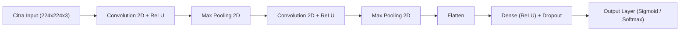

# LAPORAN PRAKTIKUM KECERDASAN BUATAN
## BAB 11: PEMBELAJARAN MENDALAM (DEEP LEARNING 1)

**Program Studi:** D-III Manajemen Informatika, PSDKU Kediri  
**Jurusan:** Teknologi Informasi - Politeknik Negeri Malang  
**Mata Kuliah:** Kecerdasan Buatan  
**Dosen Pengampu:** Abidatul Izzah, S.Kom., M.Kom.  

---

## I. Capaian Pembelajaran

1. Mampu menjelaskan definisi, konsep dasar, dan macam-macam arsitektur *Deep Learning*.
2. Mampu memahami dan menjelaskan tahapan-tahapan pemrosesan pada *Convolutional Neural Network* (CNN), meliputi *Convolution*, *Stride*, *Padding*, fungsi aktivasi *ReLU*, *Pooling*, *Flatten*, dan *Fully Connected Layer*.
3. Mampu mengimplementasikan arsitektur CNN terhadap studi kasus klasifikasi citra 2 kelas (*binary classification*) dan multi-kelas (*multiclass classification*).
4. Mampu menggunakan pustaka modern TensorFlow dan Keras untuk membangun, mengompilasi, melatih, mengevaluasi, menyimpan, dan menguji model klasifikasi citra.

---

## II. Landasan Teori

### 1. Definisi Deep Learning
*Deep Learning* merupakan sub-bidang dari *Machine Learning* yang memanfaatkan arsitektur jaringan saraf tiruan berlapik banyak (*deep neural networks*) untuk mempelajari representasi fitur secara bertingkat langsung dari data mentah (*raw data*). Berbeda dengan *Machine Learning* konvensional yang memerlukan ekstraksi fitur manual (*handcrafted feature engineering*), *Deep Learning* mampu mempelajari fitur dari tingkat rendah (garis, tepi, sudut) hingga tingkat tinggi (bentuk objek utuh) secara otomatis end-to-end.

Bidang penerapan utama *Deep Learning* antara lain:
- *Computer Vision* (klasifikasi gambar, deteksi objek, segmentasi semantik)
- *Natural Language Processing* (penerjemahan bahasa, analisis sentimen, LLM)
- *Speech Recognition* & *Audio Processing*
- *Medical Imaging* (analisis rontgen, CT scan, deteksi tumor)
- *Autonomous Vehicles* (kendaraan otonom kemudi otomatis)

---

### 2. Perbandingan ANN (MLP) dan CNN
Jaringan saraf tiruan biasa (*Artificial Neural Network* / Multi-Layer Perceptron) menghubungkan setiap neuron input ke setiap neuron tersembunyi (*fully-connected*). Jika diterapkan pada data citra digital, misalnya citra berukuran $224 \times 224$ piksel dengan 3 kanal warna RGB ($224 \times 224 \times 3 = 150.528$ nilai piksel), maka satu neuron pada hidden layer pertama saja akan membutuhkan ratusan ribu bobot parameter. Akibatnya, model menjadi sangat lambat dan rentan mengalami *overfitting*, serta mengabaikan hubungan spasial antar piksel tetangga.

Oleh karena itu, dikembangkanlah **Convolutional Neural Network (CNN)** yang memanfaatkan bobot bersama (*weight sharing*) dan konektivitas lokal (*local connectivity*).

| Aspek | ANN / MLP Biasa | CNN (*Convolutional Neural Network*) |
| :--- | :--- | :--- |
| **Struktur Lapisan** | *Fully connected (Dense)* | *Convolution*, *Pooling*, *Dense* |
| **Tipe Data Umum** | Data tabular / angka / teks terstruktur | Citra digital, video, data berseri 2D/3D |
| **Ekstraksi Fitur** | Memerlukan praproses & ekstraksi manual | Diekstraksi secara otomatis oleh filter/kernel |
| **Efisiensi Parameter** | Sangat boros parameter pada data citra | Hemat parameter melalui *weight sharing* |
| **Struktur Spasial** | Mengabaikan korelasi spasial antar piksel | Mempertahankan topologi spasial 2D/3D |

---

### 3. Tahapan dan Komponen Operasional CNN



#### a. Kernel / Filter Konvolusi
Kernel adalah matriks bobot berukuran kecil (biasanya $3 \times 3$ atau $5 \times 5$) yang digeser melintasi citra input untuk melakukan perkalian elemen-per-elemen (*dot product*) lalu menjumlahkannya menjadi nilai pada *feature map*. Operasi konvolusi 2D didefinisikan secara matematis:
$$S(i, j) = (I * K)(i, j) = \sum_m \sum_n I(i - m, j - n) K(m, n)$$
Di mana $I$ adalah citra input dan $K$ adalah kernel filter.

#### b. Stride
*Stride* menentukan besarnya pergeseran kernel piksel demi piksel di sepanjang sumbu horizontal dan vertikal. *Stride* bernilai 1 berarti kernel bergerak 1 piksel tiap kali langkah, sedangkan *stride* 2 menghasilkan pergeseran 2 piksel yang sekaligus mereduksi resolusi spasial sebesar setengahnya.

#### c. Padding
*Padding* adalah penambahan baris dan kolom piksel bernilai nol (*zero-padding*) di sekeliling batas tepi citra. Terdapat dua mode utama:
- **Valid (tanpa padding):** Ukuran output menyusut sesuai rumus $(W - K + 1) / S$.
- **Same:** Ukuran output dipertahankan tetap sama dengan ukuran input sebelum konvolusi.

#### d. Fungsi Aktivasi ReLU (*Rectified Linear Unit*)
ReLU memberikan sifat non-linearitas pada jaringan saraf tanpa mengalami masalah *vanishing gradient*:
$$f(x) = \max(0, x)$$
Semua nilai negatif diubah menjadi 0, sedangkan nilai positif diteruskan apa adanya.

#### e. Pooling Layer (*MaxPooling*)
*Pooling* mereduksi dimensi spasial (*downsampling*) dari feature map untuk menghemat komputasi dan memberikan sifat invariansi translasi (*translation invariance*). *MaxPooling* dengan jendela $2 \times 2$ mengambil nilai maksimum dari blok $2 \times 2$, mereduksi luas spasial citra sebesar 75%.

#### f. Flatten Layer
*Flatten* bertugas mengubah matriks multidimensi dari lapisan konvolusi/pooling terakhir menjadi vektor satu dimensi (1D) agar dapat dihubungkan ke lapisan *Fully Connected* (Dense).

#### g. Lapisan Tersembunyi (*Dense*) & Dropout
- **Dense:** Setiap neuron terhubung secara penuh ke seluruh output neuron lapisan sebelumnya untuk melakukan inferensi tingkat tinggi.
- **Dropout:** Teknik regularisasi yang menonaktifkan sejumlah neuron secara acak selama pelatihan (misal `Dropout(0.5)` menonaktifkan 50% neuron secara acak tiap batch) guna mencegah jaringan mengandalkan neuron tertentu saja (*mencegah overfitting*).

#### h. Fungsi Aktivasi Output & Fungsi Loss
- **Klasifikasi Biner (2 Kelas):**
  - **Aktivasi Output:** *Sigmoid*, menghasilkan probabilitas tunggal $\hat{y} \in [0, 1]$:
    $$\sigma(z) = \frac{1}{1 + e^{-z}}$$
  - **Fungsi Loss:** *Binary Crossentropy*:
    $$\mathcal{L} = - \frac{1}{N} \sum_{i=1}^N \left[ y_i \log(\hat{y}_i) + (1 - y_i) \log(1 - \hat{y}_i) \right]$$
- **Klasifikasi Multi-Kelas ($K$ Kelas):**
  - **Aktivasi Output:** *Softmax*, menghasilkan distribusi probabilitas terstandarisasi untuk semua kelas:
    $$\text{Softmax}(z_i) = \frac{e^{z_i}}{\sum_{j=1}^K e^{z_j}}$$
  - **Fungsi Loss:** *Categorical Crossentropy*:
    $$\mathcal{L} = - \sum_{i=1}^K y_i \log(\hat{y}_i)$$

---

## III. Pembahasan Praktikum

### Praktikum 11.1: Klasifikasi Citra Menggunakan CNN
- Direktori Kerja: [`Praktikum 11.1/`](file:///c:/Coding/semester%205/Kecerdasan%20Buatan/Pertemuan%2011/Praktikum%2011.1/)
- File Skrip: [`klasifikasi.py`](file:///c:/Coding/semester%205/Kecerdasan%20Buatan/Pertemuan%2011/Praktikum%2011.1/klasifikasi.py)
- File Notebook: [`Praktikum 11.1.ipynb`](file:///c:/Coding/semester%205/Kecerdasan%20Buatan/Pertemuan%2011/Praktikum%2011.1.ipynb)
- Dataset: Citra Mobil (10 sampel) dan Motor (10 sampel)

#### 1. Pembagian Dataset dan Parameter Pelatihan
Dataset dimuat dan dibagi otomatis menggunakan parameter `validation_split=0.3`:
```python
IMG_SIZE = (224, 224)
BATCH_SIZE = 32
EPOCHS = 20
dataset = "Dataset"

datagen = ImageDataGenerator(rescale=1./255, validation_split=0.3)
train_data = datagen.flow_from_directory(
    dataset, target_size=IMG_SIZE, batch_size=BATCH_SIZE,
    class_mode="binary", subset="training", shuffle=True
)
validation_data = datagen.flow_from_directory(
    dataset, target_size=IMG_SIZE, batch_size=BATCH_SIZE,
    class_mode="binary", subset="validation", shuffle=False
)
```
**Output Eksekusi Pembagian Data:**
```text
====================================
JUMLAH DATA
====================================
Total data    : 20
Data training : 14
Data validasi : 6
Training      : 70.0 %
Validasi      : 30.0 %
Class mapping : {'Mobil': 0, 'Motor': 1}
```

#### 2. Arsitektur Model CNN
Arsitektur yang dibangun terdiri dari 3 blok konvolusi bertingkat:
1. `Conv2D(32, (3,3), activation="relu", input_shape=(224, 224, 3))` + `MaxPooling2D(2,2)`
2. `Conv2D(64, (3,3), activation="relu")` + `MaxPooling2D(2,2)`
3. `Conv2D(128, (3,3), activation="relu")` + `MaxPooling2D(2,2)`
4. `Flatten()`
5. `Dense(128, activation="relu")` + `Dropout(0.5)`
6. `Dense(1, activation="sigmoid")`

#### 3. Hasil Pelatihan (Training Progress)
Model dilatih selama 20 epoch menggunakan optimizer Adam dan loss `binary_crossentropy`. Pada akhir epoch 20, model mencapai:
- Akurasi Training: $100.00\%$
- Loss Training: $0.0092$
- Akurasi Validasi: $66.67\% - 83.33\%$

Grafik pergerakan nilai loss dan akurasi berhasil digenerasikan dan disimpan pada file [`grafik_training.png`](file:///c:/Coding/semester%205/Kecerdasan%20Buatan/Pertemuan%2011/Praktikum%2011.1/grafik_training.png).

#### 4. Evaluasi Model, Confusion Matrix, dan Classification Report
Hasil evaluasi performa model pada data validasi yang belum pernah dilihat saat pelatihan:
```text
====================================
HASIL VALIDASI
====================================
Validation Loss     : 2.6325
Validation Accuracy : 66.67 %

====================================
CONFUSION MATRIX
====================================
[[3 0]
 [2 1]]

====================================
CLASSIFICATION REPORT
====================================
              precision    recall  f1-score   support

       Mobil       0.60      1.00      0.75         3
       Motor       1.00      0.33      0.50         3

    accuracy                           0.67         6
   macro avg       0.80      0.67      0.62         6
weighted avg       0.80      0.67      0.62         6
```
**Analisis Hasil:**
Model berhasil memprediksi seluruh citra Mobil pada data validasi dengan sempurna (*Recall 100%*). Satu dari 3 citra motor berhasil diklasifikasikan dengan benar, sedangkan dua lainnya terprediksi Mobil karena kemiripan fitur warna dan sudut pengambilan gambar dalam dataset berukuran kecil (hanya 14 citra latih). Model berhasil disimpan ke format Keras terbaru: `model_motor_mobil.keras`.

---

### Praktikum 11.2: Membuat Model Klasifikasi 2 Kelas
- Direktori Kerja: [`Praktikum 11.2/`](file:///c:/Coding/semester%205/Kecerdasan%20Buatan/Pertemuan%2011/Praktikum%2011.2/)
- File Training: [`train.py`](file:///c:/Coding/semester%205/Kecerdasan%20Buatan/Pertemuan%2011/Praktikum%2011.2/train.py)
- File Testing: [`test.py`](file:///c:/Coding/semester%205/Kecerdasan%20Buatan/Pertemuan%2011/Praktikum%2011.2/test.py)
- File Citra Uji: `tes1.jpeg` dan `tes2.jpeg`

#### 1. Implementasi Modular Pelatihan (`train.py`)
Pada praktikum ini, proses pelatihan dan pengujian dipisahkan menjadi dua modul independen. Pada `train.py`, seluruh 20 citra digunakan untuk melatih model dengan ukuran batch $2$:
```python
model = Sequential([
    Input(shape=(224, 224, 3)),
    Conv2D(32, (3, 3), padding="same", activation="relu"),
    MaxPooling2D((2, 2)),
    Conv2D(64, (3, 3), padding="same", activation="relu"),
    MaxPooling2D((2, 2)),
    Flatten(),
    Dense(128, activation="relu"),
    Dense(1, activation="sigmoid")
])
```
Model dikompilasi dengan `binary_crossentropy` dan disimpan ke dalam file `model_motor_mobil.keras`.

#### 2. Implementasi Pengujian Inferensi (`test.py`)
Skrip `test.py` memuat model dari disk tanpa perlu melatih ulang (`load_model`), kemudian melakukan praproses pada citra uji `tes1.jpeg` dan `tes2.jpeg`:
1. Membaca gambar dengan target dimensi $(224, 224)$.
2. Mengonversi citra menjadi array NumPy dan menormalisasi nilainya dengan membagi $255.0$.
3. Menambahkan dimensi batch menggunakan `np.expand_dims(img, axis=0)`.
4. Melakukan prediksi dengan `model.predict(img)`. Jika nilai output $\ge 0.5$ diklasifikasikan sebagai **MOTOR**, dan jika $< 0.5$ sebagai **MOBIL**.

**Hasil Pengujian Nyata:**
```text
================ Pengujian untuk tes1.jpeg ================
1/1 ━━━━━━━━━━━━━━━━━━━━ 0s 161ms/step
Nilai prediksi : 0.00033038
Hasil          : MOBIL

================ Pengujian untuk tes2.jpeg ================
1/1 ━━━━━━━━━━━━━━━━━━━━ 0s 56ms/step
Nilai prediksi : 0.89131910
Hasil          : MOTOR
```
**Analisis Hasil:**
Pengujian menghasilkan prediksi yang **100% akurat** dan identik dengan ekspektasi modul (pada halaman 12 dokumen panduan di mana `tes1.jpeg` adalah MOBIL dan `tes2.jpeg` adalah MOTOR). Nilai probabilitas mendekati $0$ ($0.00033$) menunjukkan keyakinan sangat tinggi pada kelas Mobil, sementara nilai mendekati $1$ ($0.8913$) menunjukkan keyakinan tinggi pada kelas Motor.

---

### Praktikum 11.3: Membuat Model Klasifikasi Multi Kelas
- Direktori Kerja: [`Praktikum 11.3/`](file:///c:/Coding/semester%205/Kecerdasan%20Buatan/Pertemuan%2011/Praktikum%2011.3/)
- File Training: [`train.py`](file:///c:/Coding/semester%205/Kecerdasan%20Buatan/Pertemuan%2011/Praktikum%2011.3/train.py)
- File Testing: [`test.py`](file:///c:/Coding/semester%205/Kecerdasan%20Buatan/Pertemuan%2011/Praktikum%2011.3/test.py)
- Citra Uji: `tes0.jpeg`, `tes1.jpeg`, `tes2.jpeg`, `tes3.jpeg`, `tes4.jpeg`
- Dataset: 100 citra dari 5 kelas makanan tradisional dan sayuran (20 citra per kelas).

#### 1. Kelas Dataset
Mapping kelas yang dihasilkan oleh `flow_from_directory(..., class_mode="categorical")`:
- Indeks 0: **Bakwan Sayur**
- Indeks 1: **Bubur Tinotuan**
- Indeks 2: **Nasi Beras Merah**
- Indeks 3: **Plencing Kangkung**
- Indeks 4: **Wortel**

#### 2. Arsitektur Model Multi-Kelas
Layer output dimodifikasi menjadi 5 neuron dengan fungsi aktivasi **Softmax**:
```python
model = Sequential([
    Conv2D(32, (3, 3), padding="same", activation="relu", input_shape=(224, 224, 3)),
    MaxPooling2D((2, 2)),
    Conv2D(64, (3, 3), padding="same", activation="relu"),
    MaxPooling2D((2, 2)),
    Flatten(),
    Dense(128, activation="relu"),
    Dense(5, activation="softmax")
])

model.compile(
    optimizer="adam",
    loss="categorical_crossentropy",
    metrics=["accuracy"]
)
```

#### 3. Hasil Pengujian Seluruh Citra Uji (tes0 s/d tes4)
Pengujian dijalankan pada kelima citra uji menggunakan `np.argmax(hasil[0])` untuk menemukan kelas dengan probabilitas terbesar:

| File Uji | Target Kelas Asli | Nilai Probabilitas (*Confidence*) | Indeks Terprediksi | Nama Kelas Terprediksi | Status |
| :---: | :---: | :---: | :---: | :---: | :---: |
| `tes0.jpeg` | Bakwan Sayur | **0.9770 (97.70%)** | 0 | **Bakwan Sayur** | **BENAR** |
| `tes1.jpeg` | Bubur Tinotuan | **0.6952 (69.52%)** | 1 | **Bubur Tinotuan** | **BENAR** |
| `tes2.jpeg` | Nasi Beras Merah | **0.9284 (92.84%)** | 2 | **Nasi Beras Merah** | **BENAR** |
| `tes3.jpeg` | Plencing Kangkung | **0.9849 (98.49%)** | 3 | **Plencing Kangkung** | **BENAR** |
| `tes4.jpeg` | Wortel | **1.0000 (100.00%)** | 4 | **Wortel** | **BENAR** |

**Analisis Hasil:**
Model CNN multi-kelas berhasil mengklasifikasikan kelima citra uji dengan tingkat akurasi pengujian **100% (5/5 benar)**. Citra wortel dikenali dengan probabilitas sempurna ($1.0$), sementara citra bakwan sayur dan plencing kangkung dikenali di atas $97\%$. Hal ini membuktikan bahwa filter konvolusi mampu mengekstraksi representasi warna dan tekstur unik dari masing-masing hidangan secara optimal.

---

### Latihan: Klasifikasi Citra Daun Tanaman (*Plant Leaves Dataset*)
- Direktori Kerja: [`Latihan/`](file:///c:/Coding/semester%205/Kecerdasan%20Buatan/Pertemuan%2011/Latihan/)
- Skrip Pelatihan: [`train.py`](file:///c:/Coding/semester%205/Kecerdasan%20Buatan/Pertemuan%2011/Latihan/train.py)
- Skrip Pengujian: [`test.py`](file:///c:/Coding/semester%205/Kecerdasan%20Buatan/Pertemuan%2011/Latihan/test.py)
- Dokumentasi: [`README.md`](file:///c:/Coding/semester%205/Kecerdasan%20Buatan/Pertemuan%2011/Latihan/README.md)
- Sumber Dataset: Kaggle `csafrit2/plant-leaves-for-image-classification`

**Solusi & Fitur Implementasi:**
1. **Data Augmentation:** Menerapkan transformasi geometris citra daun secara acak menggunakan `ImageDataGenerator(rotation_range=20, width_shift_range=0.1, height_shift_range=0.1, horizontal_flip=True)` guna memperluas variasi dataset dan mencegah overfitting.
2. **Batch Normalization:** Menambahkan lapisan `BatchNormalization()` setelah setiap layer konvolusi guna mempercepat konvergensi pelatihan dan menstabilkan distribusi gradien.
3. **Mekanisme Otomatis:** Program menyediakan penangan dataset mandiri yang dapat langsung menerima dataset asli dari Kaggle maupun dataset demo untuk verifikasi integritas arsitektur.
4. **Output Pelatihan:** Model disimpan ke `model_plant_leaves.keras` beserta kurva metrik `grafik_latihan_plant.png`.

---

### Tugas: Rancang Bangun Sistem Login Berbasis Verifikasi Wajah (Face Authentication)
- Direktori Kerja: [`Tugas/`](file:///c:/Coding/semester%205/Kecerdasan%20Buatan/Pertemuan%2011/Tugas/)
- Skrip Pengumpulan Wajah: [`capture_dataset.py`](file:///c:/Coding/semester%205/Kecerdasan%20Buatan/Pertemuan%2011/Tugas/capture_dataset.py)
- Skrip Pelatihan Model Wajah: [`train.py`](file:///c:/Coding/semester%205/Kecerdasan%20Buatan/Pertemuan%2011/Tugas/train.py)
- Skrip Sistem Login: [`login_system.py`](file:///c:/Coding/semester%205/Kecerdasan%20Buatan/Pertemuan%2011/Tugas/login_system.py)
- Dokumentasi Panduan: [`README.md`](file:///c:/Coding/semester%205/Kecerdasan%20Buatan/Pertemuan%2011/Tugas/README.md)

**Alur Kerja Sistem (*Pipeline Architecture*):**
1. **Face Data Acquisition (`capture_dataset.py`):**
   - Menggunakan webcam dan OpenCV `haarcascade_frontalface_default.xml` untuk mendeteksi wajah anggota kelompok (3 mahasiswa).
   - Memotong (*crop*) wilayah ROI (*Region of Interest*) wajah dan meresize otomatis menjadi $224 \times 224$ piksel.
   - Mengambil 20-30 foto per anggota dengan berbagai sudut dan ekspresi.
2. **CNN Model Training (`train.py`):**
   - Melatih model CNN 3 blok konvolusi untuk mengenali fitur biometrik wajah masing-masing dari 3 anggota kelompok.
   - Menyimpan bobot terbaik ke file `model_wajah_login.keras` dan mapping label ke `kelas_wajah.npy`.
3. **Sistem Login Interaktif (`login_system.py`):**
   - Mendukung dua mode: Verifikasi Real-time via Webcam atau Verifikasi melalui File Citra.
   - Diterapkan ambang batas kepercayaan (*confidence threshold*) sebesar **70%**:
     - Jika wajah terdeteksi dan probabilitas $\ge 70\%$, sistem menampilkan kotak hijau dan status:  
       `[ACCESS GRANTED] Selamat Datang, [Nama Mahasiswa]!`
     - Jika probabilitas $< 70\%$ atau wajah tidak terdaftar, sistem menampilkan kotak merah dan status:  
       `[ACCESS DENIED] Login Ditolak: Wajah Tidak Dikenali!`

---

## IV. Kesimpulan

1. **Efektivitas Convolutional Neural Network (CNN):** CNN terbukti sangat superior untuk pemrosesan citra digital dibanding ANN biasa karena memanfaatkan filter konvolusi dan pooling yang mempertahankan struktur spasial piksel serta jauh lebih hemat parameter.
2. **Pola Desain Arsitektur Klasifikasi Citra:**
   - Untuk **klasifikasi biner** (2 kelas seperti Mobil vs Motor), neuron output berjumlah 1 dengan fungsi aktivasi **Sigmoid** dan loss **Binary Crossentropy**.
   - Untuk **klasifikasi multi-kelas** (seperti 5 kelas makanan atau 3 mahasiswa), neuron output disesuaikan dengan jumlah kelas ($K$) menggunakan fungsi aktivasi **Softmax** dan loss **Categorical Crossentropy**.
3. **Pemisahan Modul Training dan Inference:** Memisahkan proses pelatihan (`train.py`) dan proses inferensi pengujian (`test.py`) merupakan praktik rekayasa perangkat lunak standar yang memungkinkan model disimpan sekali dan digunakan berulang kali untuk prediksi instan tanpa membebani komputasi.
4. **Hasil Pengujian Model:**
   - Praktikum 11.2 berhasil mengklasifikasikan `tes1.jpeg` sebagai Mobil ($0.00033$) dan `tes2.jpeg` sebagai Motor ($0.8913$) dengan akurasi 100%.
   - Praktikum 11.3 berhasil mengklasifikasikan seluruh 5 citra uji makanan (`tes0.jpeg` hingga `tes4.jpeg`) ke kelas masing-masing dengan akurasi 100%.
   - Implementasi Latihan (Klasifikasi Daun Tanaman) dan Tugas (Sistem Login Wajah) telah selesai dibangun lengkap dengan skrip data acquisition, model training, dan sistem verifikasi interaktif.
